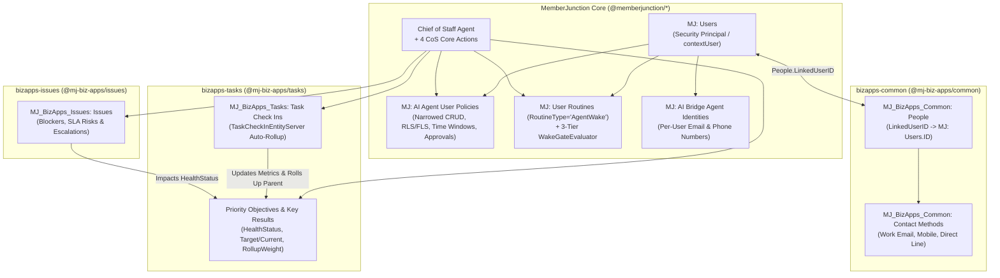
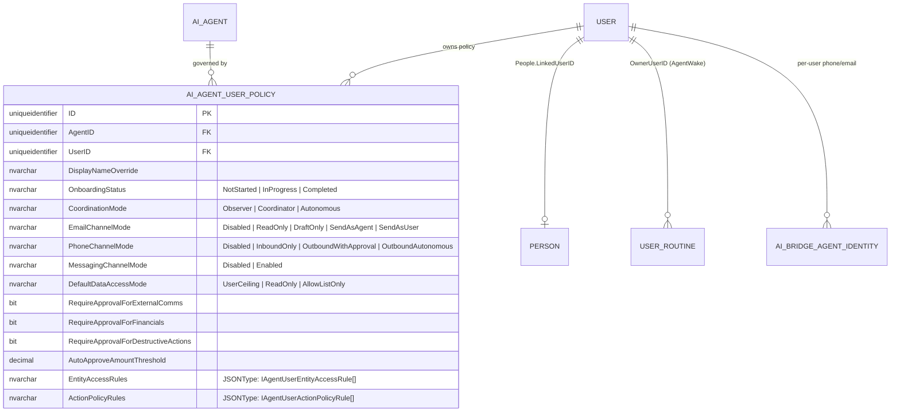
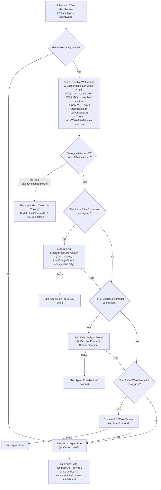
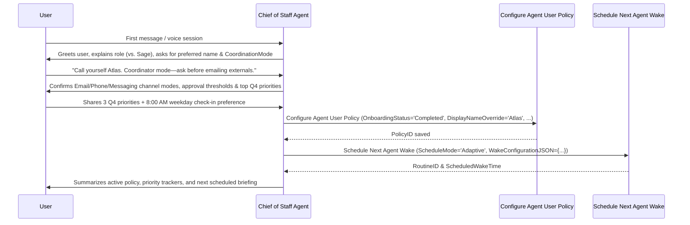
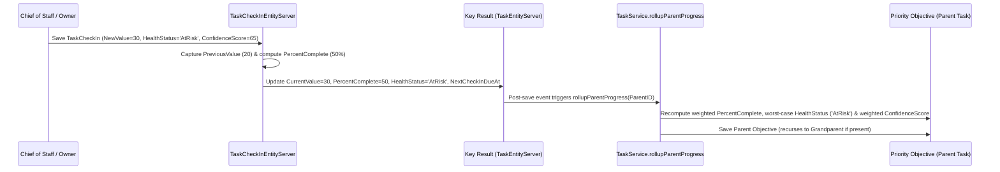

# Chief of Staff Agent Architecture & Operations Guide

> [!NOTE]
> **Why this guide lives in `bizapps-issues`**: The Chief of Staff Agent's core primitives (`MJ: AI Agent User Policies`, the 3-Tier Wake Gate on `MJ: User Routines`, per-user `AIBridgeAgentIdentity`, and the 4 Chief of Staff actions) ship in **MemberJunction Core (`MJ`)**, while its organizational work-tracking spine spans **`bizapps-common`** (`People.LinkedUserID`), **`bizapps-tasks`** (`Tasks` Priority/OKR extensions & `TaskCheckIn`), and **`bizapps-issues`** (`Issues` & escalations). Because `bizapps-issues` sits at the leaf of this dependency graph, the end-to-end reference guide is hosted here and linked from [`MJ/guides/BUILT_IN_AGENTS_GUIDE.md`](../../MJ/guides/BUILT_IN_AGENTS_GUIDE.md).

---

## 1. Purpose & Strategic Rationale

The **Chief of Staff (CoS)** is a personal, always-on AI agent for any user in an organization (`One CoS per user`). Unlike **Sage** (the ambient workspace concierge designed for reactive UI navigation and quick delegation), the Chief of Staff:
- Looks across the organization's workstreams (`Tasks`, `TaskCheckIns`, `Issues`).
- Tracks quarterly **Priority Objectives** and measurable **Key Results (OKRs)**.
- Writes executive briefings, status rollups, and decision memos.
- Triages incoming approvals and escalations.
- Follows up with colleagues (or their Chief of Staff agents) across chat, email, and voice/telephony—strictly within the user's narrowed governance policy.
- Decides on its own when to wake up next via MemberJunction's **3-Tier Wake Gate**.



---

## 2. Identity, Security & Narrowed Per-User Policies

### 2.1 Security Principal Invariant (`contextUser`)

Every Chief of Staff run—whether interactive chat, scheduled wake (`UserRoutineDispatcherDriver` / `AgentScheduledJobDriver`), durable multi-agent workflow (`TaskGraphOrchestrator`), or sub-agent call—executes as the user who owns it (`contextUser`):
1. **No Privilege Escalation**: The user's MemberJunction Entity Permissions, Row-Level Security (RLS), Field-Level Security (FLS), and scoped document retrieval form an **unbreakable ceiling**.
2. **Bridging `MJ: Users` and `MJ_BizApps_Common: People`**:
   - Security and permissions bind to `MJ: Users(ID)`.
   - Organizational ownership on Tasks and Issues binds to `MJ_BizApps_Common: People(ID)` via `People.LinkedUserID`.

### 2.2 `MJ: AI Agent User Policies` (`__mj.AIAgentUserPolicy`)

Users can narrow their Chief of Staff's capabilities below their own permission ceiling through a strongly-typed `MJ: AI Agent User Policies` record enforced at runtime by `AgentUserPolicyEngine` inside `BaseAgent`:



#### `EntityAccessRules` (`IAgentUserEntityAccessRule[]`)
Inherits the user's CRUD/RLS/FLS ceiling and supports further narrowing per entity or wildcard pattern:
- **Operation Ceiling**: `allowRead`, `allowCreate`, `allowUpdate`, `allowDelete`
- **RLS Narrowing**: `rlsFilterExpression` (additional SQL/filter predicate) and `AdditionalScopeFilter`
- **FLS Narrowing**: `ReadableFields`, `WritableFields`, `HiddenFields`
- **Time-Based Windows**: `timeWindows` (`daysOfWeek`, `startTime`, `endTime`, `timezone`)

```json
[
  {
    "entityNamePattern": "MJ_BizApps_Tasks:*",
    "allowRead": true,
    "allowCreate": true,
    "allowUpdate": true,
    "allowDelete": false
  },
  {
    "entityNamePattern": "*Invoice*",
    "allowRead": true,
    "allowCreate": false,
    "allowUpdate": false,
    "allowDelete": false,
    "HiddenFields": ["BankAccountNumber", "TaxID"]
  }
]
```

#### `ActionPolicyRules` (`IAgentUserActionPolicyRule[]`)
Controls action execution with `'Allow' | 'ApprovalRequired' | 'Deny'`, optional `conditionExpression` (`SafeExpressionEvaluator`), and `timeWindows`:

```json
[
  {
    "actionNamePattern": "Send Single Message",
    "policy": "ApprovalRequired",
    "timeWindows": [
      {
        "daysOfWeek": ["Mon", "Tue", "Wed", "Thu", "Fri"],
        "startTime": "08:00",
        "endTime": "18:00",
        "timezone": "America/Chicago"
      }
    ]
  }
]
```

---

## 3. Self-Scheduling & the 3-Tier Wake Gate (`MJ: User Routines`)

Instead of holding open an idle LLM process, an autonomous agent run completes cleanly (`Status = 'Completed'`) and calls **`Schedule Next Agent Wake`**, which creates or updates a row in `MJ: User Routines` with:
- `RoutineType = 'AgentWake'` (hidden from the default User Routines UI list unless the user toggles **"Agent Wakes (N)"** in the User Routines Command Center).
- `ScheduleMode = 'OneShot' | 'Adaptive' | 'Recurring'`.
- `WakeConfiguration` (`JSONType: IRoutineWakeConfiguration`).

When the routine's `NextRunAt` arrives, `UserRoutineDispatcherDriver` runs `WakeGateEvaluator.Instance.Evaluate()` **before** invoking the agent:



---

## 4. First-Run Onboarding Flow

When a user interacts with their Chief of Staff for the first time (`OnboardingStatus = 'NotStarted'` or `'InProgress'`), the agent conducts a structured onboarding conversation by voice or text:



---

## 5. Priority / OKR & Issue Tracking Across `bizapps-tasks` and `bizapps-issues`

### 5.1 Priority Objectives, Key Results & `TaskCheckIn` Rollup

`bizapps-tasks` models strategic priorities and OKRs directly on `MJ_BizApps_Tasks: Tasks` using seeded Task Types (`PRIORITY_OBJECTIVE` and `KEY_RESULT`) and 12 tracking fields (`HealthStatus`, `ConfidenceScore`, `BaselineValue`, `TargetValue`, `CurrentValue`, `UnitOfMeasure`, `MetricDirection`, `RollupWeight`, `PlanningPeriod`, `CheckInCadence`, `LastCheckInAt`, `NextCheckInDueAt`), paired with `MJ_BizApps_Tasks: Task Check Ins` (`TaskCheckIn`):



### 5.2 Connecting Issues (`bizapps-issues`) to Priorities

- Blocking issues in `MJ_BizApps_Issues: Issues` link to tasks and key results via `MJ_BizApps_Tasks: Task Links` or `MJ_BizApps_Issues: Issue Links`.
- Including `MJ_BizApps_Issues: Issues` in the Chief of Staff's Tier 0 `entityWatches` allows the agent to wake up when a high-severity issue is created or escalated, correlate it with the affected Key Result, and alert the user with recommended mitigation steps.

---

## 6. Multi-Channel & Peer Coordination Guardrails

1. **Inter-Agent Coordination (`Chief of Staff Inter-Agent Request`)**:
   - Enables User A's Chief of Staff to send a structured coordination request to User B's Chief of Staff (resolving User B via `TargetUserID` or `People.LinkedUserID` from `TargetPersonID`).
   - Enforces `CoordinationMode != 'Observer'` on the sender and isolates the request inside User B's Chief of Staff conversation so User B's CoS evaluates it under User B's own permissions and policy.
2. **Outbound Telephony (`Prepare Chief of Staff Outbound Call`)**:
   - Validates the user's `PhoneChannelMode` (`Disabled`, `InboundOnly`, `OutboundWithApproval`, `OutboundAutonomous`).
   - Generates a mandatory `DisclosureGreeting` (*"Hello [Recipient], I am [AgentName], an AI assistant calling on behalf of [UserName]..."*), enforces `ProhibitedCommitments`, and structures a tight `Objective` and `FallbackPlan`.
